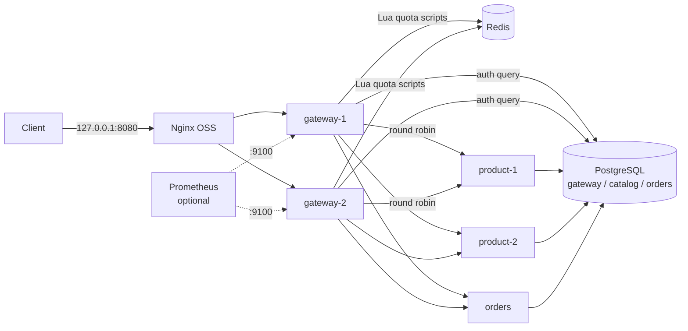

# Project Report — API Gateway with Distributed Rate Limiting

**Scalable Request Routing and Backend Load Management**

| | |
|---|---|
| Date | 21 November 2026 |
| Environment | Windows 11 + Docker Desktop (Linux containers), Python 3.12 |
| Status | All 13 planned phases implemented; 202 automated tests passing; fresh-deployment verified |
| Companion documents | [README.md](README.md) (how to run), [PROJECT_STATUS.md](PROJECT_STATUS.md) (check-by-check status), [docs/](docs/) (architecture, design, failure policy, benchmarks, interview notes) |

---

## Contents

1. [Executive summary](#1-executive-summary)
2. [Goals and scope](#2-goals-and-scope)
3. [System architecture](#3-system-architecture)
4. [Component reference](#4-component-reference)
5. [Request lifecycle](#5-request-lifecycle)
6. [Authentication](#6-authentication)
7. [Distributed rate limiting](#7-distributed-rate-limiting)
8. [Routing, forwarding and balancing](#8-routing-forwarding-and-balancing)
9. [Capacity, deadlines and resource bounds](#9-capacity-deadlines-and-resource-bounds)
10. [Failure handling](#10-failure-handling)
11. [Data model and database](#11-data-model-and-database)
12. [Telemetry](#12-telemetry)
13. [Deployment and configuration](#13-deployment-and-configuration)
14. [Verification: testing strategy and results](#14-verification-testing-strategy-and-results)
15. [Defects found during development](#15-defects-found-during-development)
16. [Performance: smoke benchmark](#16-performance-smoke-benchmark)
17. [Limitations](#17-limitations)
18. [Recommended next steps](#18-recommended-next-steps)
19. [Appendix A — repository inventory](#appendix-a--repository-inventory)
20. [Appendix B — versions](#appendix-b--versions)
21. [Appendix C — configuration reference](#appendix-c--configuration-reference)

---

## 1. Executive summary

The project delivers a locally runnable API gateway in front of two PostgreSQL-backed services
(products and orders), built from scratch in this repository with no paid services or API keys.

What the system does, end to end:

- **One entry point.** Nginx Open Source is the only published port (`127.0.0.1:8080`) and
  balances across **two gateway instances**.
- **Authentication.** Each gateway authenticates the caller's API key against PostgreSQL.
- **Shared quotas.** Quotas are enforced **across both gateways at once** through atomic Redis Lua
  scripts. Two algorithms are implemented — **token bucket** and **sliding-window log** — and the
  algorithm is chosen per client by policy.
- **Routing and balancing.** `/products` goes to two product instances (round robin over healthy
  ones); `/orders` goes to the order service.
- **Protection.** Overload is rejected immediately (no queues); bodies are size-bounded while being
  read; every upstream exchange has one total deadline; failures map to defined status codes.
- **Observability.** Structured JSON logs and Prometheus metrics with bounded labels.

How correctness was established — not by assertion, but by evidence:

- **202 automated tests** pass (119 unit, 83 integration including 9 disruptive failure tests) against
  real PostgreSQL 17.7, Redis 8.2.11 and Nginx 1.28.3.
- A **fresh isolated deployment** with new volumes was started and exercised through the documented
  steps, including a full restart.
- A **smoke benchmark** of six workloads ran with zero unintended errors.
- The checks found **nine defects**, all fixed with regression tests — the most significant being a
  DNS-starvation failure that made a *healthy* backend fail when another one stopped (§15).

The main honest caveats: performance figures are short smoke runs on a shared laptop (a gateway
process saturates one CPU at ~190 req/s), and PostgreSQL, Redis and Nginx are single instances (§17).

---

## 2. Goals and scope

### In scope (delivered)

| Requirement | Delivered as |
|---|---|
| Authenticate API clients | API keys (`gwk_<id>_<secret>`), SHA-256 digests, PostgreSQL lookup, admin CLI |
| Shared quotas across two gateways | Redis Lua token bucket + sliding-window log, Redis `TIME` clock |
| Route to configured backends | Fixed routes `/products`, `/orders`; destinations from configuration |
| Balance products across healthy instances | Per-gateway round robin + readiness probes + passive failure detection |
| Bound concurrency and sizes | Immediate admission (global + per service), 64 KiB / 1 MiB body limits |
| Predictable failures and deadlines | Defined 401/404/429/502/503/504 semantics, 5 s total upstream deadline |
| Logs and metrics | JSON request logs, Prometheus metrics, internal metrics port |
| Products and orders services | Keyset-paginated catalog; orders with trusted price snapshots and ownership |

### Explicitly out of scope

Payments, stock reservation, shipping, refunds; Kafka, Kubernetes, a frontend; large uploads,
streaming responses, WebSockets; external deployment.

### Expected outcomes (as specified, all implemented)

| Status | Meaning |
|---|---|
| 401 | missing or invalid authentication |
| 404 | unknown gateway route |
| 429 | quota exhausted, with `Retry-After` |
| 503 | admission capacity exhausted, required dependency unavailable, or no healthy backend |
| 502 | upstream connection/protocol failure |
| 504 | upstream processing deadline exceeded |
| any other | the backend's own status, preserved unchanged |

---

## 3. System architecture

**Topology (normal deployment):** 1 Nginx, 2 gateways, 2 product instances, 1 order service,
1 Redis, 1 PostgreSQL, optional Prometheus. Every application container runs exactly one Uvicorn
process. Only Nginx publishes a port, and only on localhost.

**Key architectural choices:**

- **Stateless gateways.** All shared state (quotas) lives in Redis and all identity data in
  PostgreSQL, so either gateway can serve any request.
- **Atomic decisions in Redis.** The quota read-decide-write runs as one Lua script, eliminating
  races between gateways (§7).
- **Fail closed.** If a quota decision or authentication cannot be obtained, the request is
  rejected with 503 rather than allowed unchecked.
- **No silent replays.** Neither Nginx nor the gateway re-sends a request that may already have
  reached a backend (§8).
- **Bounded everything.** Every queue, pool, body and wait has an explicit limit (§9).

---

## 4. Component reference

### Gateway (`gateway/app/`)

| Module | Responsibility |
|---|---|
| `main.py` | App factory and lifecycle: opens pools, runs first health-probe round before serving, starts/stops background tasks, closes all clients on shutdown |
| `service.py` | The request pipeline (§5), error responses, log/metric emission |
| `config.py` | Environment parsing with validation (fails fast on bad settings) |
| `routing.py` | Segment-boundary route matching, raw-path safety checks, bounded route templates |
| `keys.py` | API key generation (CSPRNG), parsing, SHA-256 verification |
| `auth.py` | Single-query PostgreSQL authentication returning client + policy |
| `ratelimit/` | `token_bucket.lua`, `sliding_window.lua`, Python wrapper (`limiter.py`), policy validation |
| `admission.py` | Immediate, non-queuing capacity slots (AnyIO `CapacityLimiter`) |
| `backends.py` | Instance health state machine, round robin, health monitor, off-request-path DNS |
| `proxy.py` | Header filtering (hop-by-hop, identity, credentials), chunk-wise bounded body I/O, upstream send |
| `metrics.py` | Prometheus metric definitions with bounded labels |
| `errors.py` | Gateway error taxonomy and status mapping |
| `../admin.py` | Administrative CLI |

### Backend services (`services/`)

| Service | Endpoints | Notes |
|---|---|---|
| products | `GET/HEAD /products?limit=&after_id=`, `GET/HEAD /products/{id}`, `/health/live`, `/health/ready` | Keyset pagination (limit 1–100); 404 for missing; `X-Instance-Id` dev header |
| orders | `POST /orders`, `GET /orders/{id}`, health endpoints | Strict body validation; price from catalog; ownership in SQL |

### Shared code (`shared/`)

`env.py` (typed settings), `logging.py` (JSON formatter), `db.py` (bounded asyncpg pool mapping
failures to "unavailable"), `service.py` (backend middleware, error bodies, health endpoints),
`devcontrols.py` (development-only fault injection).

### Database (`database/`)

`manage.py` (setup command: migrate, set role passwords, seed, status), 4 migrations, 2 seed files.

### Infrastructure (`config/`, compose files, `Dockerfile`)

Nginx configuration, Redis configuration, Prometheus scrape configuration, one shared Python image,
`compose.yaml` (normal), `compose.test.yaml` (isolated test/benchmark override).

---

## 5. Request lifecycle

Each request passes through a fixed sequence of checks. Each step either continues or produces
exactly one status.

| # | Step | Possible result | Notes |
|---|---|---|---|
| 1 | Request id | — | Accept one valid `X-Request-ID` (`[A-Za-z0-9._-]{1,64}`) or generate one |
| 2 | Route match | 404 | `/products` and `/products/...` match; `/products-other` does not |
| 3 | Path safety, declared size | 400 / 413 | Rejects dot segments, encoded `/` `\` `.`, NUL; oversized `Content-Length` |
| 4 | Global admission | 503 | Immediate; before any database or Redis work |
| 5 | Authentication | 401 / 403 / 503 | One PostgreSQL query; 503 if PostgreSQL unavailable |
| 6 | Quota decision | 429 / 503 | One Lua script; **allowance consumed from here on** |
| 7 | Body read | 413 / 408 | Chunk-wise, ≤ 64 KiB, ≤ 5 s |
| 8 | Per-service admission | 503 | Immediate |
| 9 | Backend selection | 503 | Round robin over healthy instances |
| 10 | Forward | 502 / 504 | One total 5 s deadline; GET/HEAD/OPTIONS retried once only on connect failure |
| 11 | Relay | backend status | Status preserved; headers filtered; `Content-Length` recomputed |

Every response carries `X-Request-ID`; successful responses also carry `X-RateLimit-Limit` and
`X-RateLimit-Remaining`.

---

## 6. Authentication

- **Key format:** `gwk_<key_id>_<secret>` — `key_id` is 16 hex characters (64 random bits), a
  public identifier used for lookup and logs; `secret` is 43 URL-safe characters (256 random bits
  from the OS CSPRNG via Python `secrets`).
- **Storage:** only `SHA-256(full key)` plus metadata. A slow password hash (bcrypt/argon2) exists to
  protect *low-entropy human passwords*; a uniformly random 256-bit secret cannot be brute-forced
  offline, so a fast hash is appropriate and keeps verification cheap. Comparison is constant time.
- **Lifecycle:** the admin CLI creates clients, issues keys (raw key printed exactly once), revokes
  keys, (de)activates clients and assigns policies. Expiry is checked with the database clock.
- **Uniform failures:** missing, malformed, unknown, wrong-secret, revoked, expired and
  inactive-client cases all return the same 401 body (no enumeration); the specific reason is logged.
  A client with no policy gets 403.
- **No caching:** one indexed query per request; revocation is immediate. Caching was deliberately not
  added because no measurement showed a need.
- **Identity propagation:** the gateway strips any client-supplied `X-Client-Id`, `X-Client-Name`,
  `X-Gateway-*`, `Authorization`, `X-API-Key` and forwarding headers, then sets `X-Client-Id` to the
  authenticated id. The API key never reaches a backend. Backends trust this header **only because
  they are reachable solely on the private container network** (documented limitation).

---

## 7. Distributed rate limiting

### Common design

- **Atomicity.** Each decision is one Lua script (`EVALSHA`) that reads state, decides, writes and
  sets expiry. Redis executes scripts atomically, so concurrent requests on both gateways cannot
  interleave a check with an update.
- **Shared clock.** The script reads `redis.call('TIME')`, giving all gateways one clock. This is a
  wall clock, not a monotonic one; backward steps are handled conservatively (no allowance minted).
- **Keys** are scoped by authenticated client and policy: `rl:tb:c<client>:p<policy>` /
  `rl:sw:c<client>:p<policy>`. One global policy per client.
- **Policy changes.** Policies are immutable (database trigger). Changing limits means creating a new
  policy and reassigning; the client then starts fresh under the new policy and old state expires.
  Live changes are excluded from baseline correctness tests.
- **Consumption rule.** Once allowed, the allowance is spent even if a later check or the backend
  fails (tested).
- **Failure policy.** Any Redis error — connection, timeout, out-of-memory, loading — yields 503.
  Client retries are disabled (redis-py 8 defaults to 10 retries, which could double-charge after a
  timeout). The only retry is after `NOSCRIPT`, which guarantees the script did not run.
- **Redis configuration.** `maxmemory-policy noeviction` (quota keys are never silently evicted;
  writes fail and the gateway fails closed); scripts use the `#!lua` header so Redis refuses to start
  them when out of memory; persistence is AOF with `appendfsync everysec`.

### Token bucket

- State: tokens and last-refill timestamp.
- **Exact integer arithmetic:** one token is stored as `period_us` units, so each elapsed microsecond
  adds exactly `refill_tokens` units — no rounding, no drift. Validation bounds keep every value
  below 2⁵³ so Lua's doubles are exact.
- Refills up to capacity; each allowed request consumes one token; `Retry-After` is computed from the
  deficit.
- Backward clock: no refill and the timestamp never moves back.
- Expiry: an absent key means a full bucket, and the TTL is the time until the bucket would be full
  (+1 s), so expiry never changes behaviour.

### Sliding-window log

- State: a sorted set of **accepted** events scored by microsecond timestamp.
- **Window boundary:** an event counts for a decision at time `now` iff `now − W < t ≤ now`; it stops
  counting exactly `W` after acceptance.
- Expired entries are removed, the count is compared to the limit, and the event is added **only if
  allowed** (rejections never extend the window).
- Members are `timestamp:128-bit-random-nonce`, unique even for simultaneous requests.
- `Retry-After` comes from the next relevant expiration; TTL is based on the newest event, which
  stays correct under backward clock steps.
- Limit capped at 10 000 events per window to bound memory and script time.

### Evidence

- Deterministic tests run the *same* script bodies with an injected clock (production always uses
  Redis `TIME`).
- 60 concurrent requests split across both gateways against a capacity of 20 produced exactly 20
  successes (allowing ≤ 1 refill token).
- Under load, a 50 req/s quota admitted 51.5 req/s versus a theoretical 51.7 req/s (burst included).

---

## 8. Routing, forwarding and balancing

### Forwarding

- One long-lived HTTPX client per service, pool size equal to that service's admission limit,
  explicit connect/read/write/pool timeouts, redirects and retries disabled.
- Method, raw path, query string and body are preserved; `Host` is rebuilt for the backend.
- Removed in both directions: hop-by-hop headers and any header named in `Connection`. Repeated
  headers (for example `Set-Cookie`) are preserved in order.
- The backend's raw (still encoded) bytes are relayed, so `Content-Encoding` stays valid and
  `Content-Length` is recomputed from the bytes actually sent. HEAD, 204 and 304 semantics are
  handled.
- Gateway-owned headers coming from a backend (request id, rate-limit headers, instance headers) are
  dropped so they cannot be duplicated or spoofed.

### Balancing and health

- **Nginx → gateways:** round robin with passive failure handling (`max_fails=2 fail_timeout=5s`) —
  Nginx Open Source has no active health checks. `proxy_next_upstream off` guarantees a request is
  never replayed on the other gateway. Names are re-resolved every 5 s so recreated containers are
  picked up.
- **Gateway → products:** each gateway independently probes `/health/ready` every 2 s (0.5 s
  timeout). Instances start in an `unknown` (non-routable) state, the first probe round runs before
  serving, 2 consecutive failures eject an instance and 2 consecutive successes restore it.
  Connection and protocol errors on real requests also count as failures.
- **Retry rule:** only a *connect* failure (the request never left the gateway) is retried, once, on
  another healthy instance, and only for GET/HEAD/OPTIONS. Order creation is never retried.
- **DNS:** backend names are resolved by the health monitor, at most one lookup in flight per
  instance; requests connect to the cached address with the original `Host` header (§15, defect 6).

---

## 9. Capacity, deadlines and resource bounds

### Admission

Requests acquire a slot without waiting (`acquire_on_behalf_of_nowait`); if none is free the
response is an immediate 503 — there is no unbounded queue. Slots are released on every path,
including exceptions and client cancellation (tested). Limits per gateway process: **100 global,
50 products, 20 orders**. These are per process: two gateways admit twice as much; there is no
global in-flight limit.

### Coordinated limits

| Layer | Limit |
|---|---|
| Nginx | body 64 KiB, header/body timeouts 5 s, connect 1 s, read 10 s |
| Gateway Uvicorn | `--limit-concurrency 150` (above app admission, so the app's JSON 503 normally acts first) |
| Gateway admission | 100 global / 50 products / 20 orders |
| Gateway HTTPX pools | connections = service limit; pool wait 0.5 s |
| Gateway PostgreSQL pool | 10 connections; acquire 1 s; statement 2 s |
| Gateway Redis pool | 20 connections; wait 0.5 s; socket 0.5 s |
| Backend Uvicorn | `--limit-concurrency 120` |
| Backend PostgreSQL pools | 10 connections; acquire 1 s; statement 2 s |
| PostgreSQL | `max_connections 100`, `statement_timeout 5 s` |

Keep-alive timeouts are ordered (client side always shorter than server side) so no component
reuses a connection the other end is closing.

### Deadlines

The 5-second **total** upstream deadline covers backend selection, connect, send, waiting and
reading the body, including the single connect retry. This matters because HTTPX read timeouts apply
per read: a backend trickling one byte every few seconds never trips them, but does trip the total
deadline (tested).

### Size bounds

Request bodies ≤ 64 KiB and responses ≤ 1 MiB are enforced *while reading chunks*, for both
`Content-Length` and chunked transfers — nothing is buffered unboundedly. Oversized requests get 413;
oversized responses get 502 and the upstream connection is closed.

### Overload precedence

Earlier layers act first: Nginx (413/408/502/504) → gateway Uvicorn concurrency limit (plain 503) →
global admission (JSON 503, no quota consumed) → authentication → quota (429; allowance consumed
from here) → body checks → per-service admission (503) → backend's own statuses.

---

## 10. Failure handling

| Failure | Behaviour | Verified by test |
|---|---|---|
| Redis down / timeout / out of memory | 503 `dependency_unavailable`, `Retry-After: 1`, automatic recovery | yes |
| Redis restart | state restored from AOF (≤ ~1 s may be lost); script cache reloaded | yes |
| PostgreSQL down | 503; pools reconnect after recovery | yes |
| One product instance stopped | ejected; GETs retried on the healthy instance — **zero client errors in the test** | yes |
| Product readiness failing | ejected within ~2 probe intervals, restored after 2 successes | yes |
| Orders service down | 502/503; POST never replayed | yes |
| Slow backend | 504 at 5 s; excess concurrency rejected immediately | yes |
| One gateway down | Nginx stops routing to it after failures (a few 502s first, by design) | yes |
| Quota across restarts | exhausted quota stays exhausted after gateway and Redis restarts | yes |
| Client cancels mid-request | slots released, upstream response closed | yes (unit) |

**Non-idempotent requests:** after a 502/504 on `POST /orders`, the order may or may not have been
committed; clients must check. Idempotency keys are a recommended extension (§18).

---

## 11. Data model and database

### Schemas and ownership

| Schema | Tables | Application role and access |
|---|---|---|
| `gateway` | `clients`, `api_keys`, `rate_limit_policies`, `client_policy_assignments` | `gateway_app`: SELECT only (administration uses the owner role via the CLI) |
| `catalog` | `products` | `catalog_app`: SELECT; `orders_app`: SELECT (documented read-only price lookup) |
| `orders` | `orders` | `orders_app`: SELECT, INSERT |

### Integrity

- Foreign keys, uniqueness constraints, and CHECK constraints on names, sizes and policy parameters
  (each algorithm requires exactly its own parameters).
- A trigger makes rate-limit policies immutable.
- Orders: quantity 1–1000; integer prices in minor units (cents); a CHECK guarantees
  `total = unit_price × quantity`.
- Order creation is a single atomic `INSERT … SELECT` that reads the price from the catalog — the
  client cannot supply a price (extra fields are rejected with 422). An unknown product yields 422.
- Order retrieval filters by `id AND client_id`, so another client's order is indistinguishable from
  a missing one (404).

### Setup process

Migrations run in a one-shot `setup` container before applications start, under a PostgreSQL
advisory lock (concurrent runs serialize safely — tested). Each migration runs in its own transaction
with a checksum record; editing an applied migration is detected. Seeds are idempotent: three
policies and 1000 deterministic products.

### Coupling

One PostgreSQL instance holds all three schemas, and orders reference the catalog by foreign key.
This is a documented local-development simplification and a single point of failure.

---

## 12. Telemetry

### Structured logs

One JSON line per request with: request id, gateway instance, client id (when known), public key id,
method, **bounded route template** (for example `/products/{id}`), backend instance, status, outcome,
failure category, rate-limit outcome, total and upstream duration. Raw keys, bodies, raw paths and
query strings are never logged (tested).

### Prometheus metrics

| Metric | Labels |
|---|---|
| `gateway_requests_total` | route template, status class, outcome |
| `gateway_success_latency_seconds` (histogram) | route template — successes only |
| `gateway_upstream_latency_seconds` | service |
| `gateway_rate_limit_decisions_total` | algorithm, result |
| `gateway_redis_decision_seconds` (histogram) | algorithm |
| `gateway_capacity_rejections_total` | scope |
| `gateway_dependency_failures_total` | dependency |
| `gateway_upstream_timeouts_total` | service |
| `gateway_in_flight_requests`, `gateway_upstream_in_flight_requests` | — / service |
| `gateway_backend_healthy` | service, configured instance |

All labels come from fixed sets; client ids, request ids and paths are never labels (tested).
Metrics are served on an internal port (9100) that Nginx does not route; Prometheus scrapes each
gateway separately (verified: both targets `up`).

---

## 13. Deployment and configuration

- **Normal deployment** (`compose.yaml`): only Nginx published on `127.0.0.1:8080`; all images pinned
  by digest; per-container CPU/memory limits; one shared Python image (non-root user).
- **Test/benchmark override** (`compose.test.yaml`): always used under a separate project name
  (`apigw-test`, own volumes); publishes internal ports on `127.0.0.1` only and enables development
  fault controls.
- **Optional profiles:** `observability` (Prometheus UI on `127.0.0.1:9090`), `tools` (admin CLI),
  `loadtest` (Locust).
- **Development controls** (delay, injected 5xx, failed readiness) are disabled by default, not even
  registered in the normal deployment, and unreachable through gateway routes in every path form
  tested.
- **Dependencies:** pinned with hashes in `requirements.lock` / `requirements-dev.lock`, installed with
  `--require-hashes`.

Exact commands for every task (environment, configuration, start, setup, keys, requests, orders,
tests, load tests, stop, destructive reset) are in [README.md](README.md).

---

## 14. Verification: testing strategy and results

### Strategy

| Layer | Approach |
|---|---|
| Unit (119 tests, no containers) | Pure functions plus the **real gateway pipeline** driven in-process with fake auth/limiter and a mock upstream — covers forwarding, limits, deadlines, overload, cancellation and telemetry deterministically |
| Integration (74 tests) | Real PostgreSQL, Redis and backends in the isolated stack: auth, schema constraints and privileges, both Lua algorithms, end-to-end requests through Nginx and both gateways |
| Disruptive (9 tests) | Stop/slow/restart containers of the isolated stack only, restore afterwards, and verify behaviour and recovery |

Timing-sensitive quota tests account for refill and tolerance instead of asserting brittle exact
counts; algorithm details are tested deterministically with an injected clock. If the test stack is
not running, integration tests are reported as **skipped**, never as passed.

### Results (final run after all fixes)

| Check | Result |
|---|---|
| Static analysis (`ruff`) | all checks passed |
| Unit tests | 119 passed |
| Full suite (unit + integration + disruptive) | **202 passed** in 71 s |
| Compose configuration (normal and test) | valid |
| Hash-locked dependency install + `pip check` | clean |
| Fresh isolated deployment (new project, new volumes) | migrations and seeds applied; only Nginx published; key issued; product, pagination, 401, order create/retrieve, dev-control 404 all correct; 40 rapid requests → 25×200 + 15×429 shared by both gateways; quota still exhausted and orders persisted after a full restart |
| Prometheus scraping | both gateways scraped, both `up` |

---

## 15. Defects found during development

All were found by the checks described above, fixed, and covered by regression tests.

| # | Defect | Impact | Fix |
|---|---|---|---|
| 1 | Inline comments in `redis.conf` | Redis crash loop | comments moved to own lines |
| 2 | SQL parameter inferred as two types | order creation returned 500 | explicit casts |
| 3 | Token-bucket rounding | refill up to 0.2 % slow at low rates | exact integer units (1 token = `period_us` units) |
| 4 | Backend `X-Request-ID` relayed | duplicate request-id headers | gateway-owned headers stripped from upstream responses |
| 5 | Product routes without HEAD | HEAD returned 405 | explicit GET+HEAD routes |
| 6 | **DNS starvation** | stopping product-1 made the *healthy* product-2 fail (29/30 requests 502) | DNS moved off the request path, single-flight per instance |
| 7 | Nginx stale peers after gateway recreation | 502s for ~5–10 s | resolver validity shortened to 5 s; documented |
| 8 | Test isolation after disruptive tests | follow-on test failures | autouse restore fixture with fresh connections |
| 9 | Benchmark summary recorded 0 users | reporting only | configured user count recorded |

**Defect 6 in detail.** Inside Docker, resolving the name of a *stopped* container takes about four
seconds (the embedded DNS forwards it upstream). Name resolution runs in a small thread pool whose
threads cannot be cancelled. Every health probe and request for the stopped instance started another
lookup, the pool filled, and lookups for the healthy instance queued behind them until their connect
timeout expired. The fix resolves names only in the health monitor, keeps at most one lookup in
flight per instance, and connects requests to the last resolved address. After the fix, 30 of 30
requests succeeded during the same outage.

---

## 16. Performance: smoke benchmark

> These are **smoke** measurements: 10 s warm-up + 30 s measured per workload, on a laptop
> (Intel Core i5-1235U, 15.7 GB RAM; Docker: 12 CPUs, 7.6 GiB), with the load generator on the same
> machine. Python services are limited to 1 CPU each. They are not sustained-capacity results.
> Figures such as 500 req/s or 100/200 ms P95/P99 were illustrative targets and were **not** achieved
> or claimed.

| Workload | Users | Achieved req/s (all / successful) | 429 | 503 capacity | Other errors | Success P50 / P95 / P99 (ms) |
|---|---|---|---|---|---|---|
| Direct backend baseline | 20 | 587.7 / 587.7 | 0 | 0 | 0 | 29 / 61 / 88 |
| One gateway | 20 | 193.0 / 193.0 | 0 | 0 | 0 | 88 / 203 / 304 |
| Two gateways via Nginx | 20 | 249.0 / 249.0 | 0 | 0 | 0 | 64 / 226 / 353 |
| Product/order mix | 20 | 245.8 / 245.8 | 0 | 0 | 0 | 67 / 219 / 340 |
| Quota exhaustion (200 req/s offered, 50 req/s quota) | 20 | 199.8 / 51.5 | 4 425 | 0 | 0 | 29 / 42 / 54 |
| Slow backend +200 ms (800 req/s offered) | 80 | 251.8 / 108.0 | 0 | 4 279 | 0 | 412 / 1 296 / 1 888 |

Rejected responses are excluded from the latency percentiles.

**Findings:**

- **The gateway process is the bottleneck:** one gateway uses its full CPU at ~190 req/s (~5 ms CPU
  per proxied request). The cost breakdown has **not** been profiled.
- Two gateways reached 249 req/s; the scaling is limited by sharing the laptop's CPU with every other
  container and the load generator, which this run cannot separate.
- Quota enforcement under load matched theory (51.5 vs 51.7 req/s).
- Under overload, excess requests were shed immediately with 503 — zero timeouts, zero other errors.

Raw results (Locust CSVs, outcome summaries, resource snapshots) are saved in
`load_tests/results/20261121-010336/`; methodology is in [docs/benchmarks.md](docs/benchmarks.md).

---

## 17. Limitations

- **Single points of failure:** one PostgreSQL (all schemas), one Redis (all quota state), one Nginx,
  one host. Redis can lose ~1 s of quota updates in a crash; deleting its volume resets all quotas.
- **Per-process limits:** no global concurrency limit across gateways.
- **Shared wall clock:** Redis `TIME` removes skew between gateways but is not immune to clock
  adjustments on the Redis host.
- **Nginx Open Source:** passive health only; a dead gateway causes a few 502s before it is skipped;
  recreated gateways take ~5–10 s to be picked up.
- **Authentication on every request:** a PostgreSQL outage stops all traffic.
- **Backend trust:** identity headers are trusted only because of network isolation.
- **Unsupported:** large uploads, streaming responses, WebSockets.
- **Policies:** one global policy per client; reassignment starts a fresh allowance.
- **Orders:** no idempotency keys.
- **Performance evidence:** short local smoke runs only; gateway CPU cost not profiled.
- **Not tested:** graceful draining of in-flight requests during container stop; sustained load.

---

## 18. Recommended next steps

1. **Profile the gateway** under the one-gateway workload before any optimization; only then consider
   an authentication cache or other changes.
2. **Idempotency keys** for `POST /orders`, so clients can safely retry after 502/504.
3. **High availability:** Redis with replication/Sentinel (and a decision on quota semantics during
   failover), PostgreSQL replication, redundant entry points.
4. **Backend authentication:** mTLS or signed identity tokens between gateway and backends.
5. **Longer, open-loop benchmarks** on separate load-generator hardware.
6. **Per-route or multi-scope policies** if business needs require them.

---

## Appendix A — repository inventory

| Area | Files | Lines | Contents |
|---|---|---|---|
| `gateway/` | 19 | 2 028 | gateway application, Lua scripts, admin CLI |
| `services/` | 5 | 214 | products and orders services |
| `shared/` | 6 | 417 | settings, logging, DB pool, dev controls, service plumbing |
| `database/` | 8 | 334 | setup command, 4 migrations, 2 seeds |
| `tests/` | 13 | 2 096 | 118 test functions → 202 test cases (parametrized) |
| `load_tests/` | 1 | 150 | Locust workloads (+ raw results directory) |
| `scripts/` | 3 | 216 | test-stack and benchmark helpers, results summarizer |
| `config/` | 3 | 115 | Nginx, Redis, Prometheus |
| `docs/` | 5 | 558 | architecture, design decisions, failure policy, benchmarks, interview notes |
| root | — | — | `compose.yaml`, `compose.test.yaml`, `Dockerfile`, `pyproject.toml`, lock files, `.env.example`, README, status, this report |

## Appendix B — versions

| Component | Version |
|---|---|
| Python | 3.12 (containers 3.12.16) |
| FastAPI / Starlette / Uvicorn | 0.165.0 / 1.10.0 / 0.54.0 |
| HTTPX / AnyIO | 0.28.1 / 4.16.0 |
| asyncpg / redis-py / prometheus-client | 0.32.0 / 8.1.0 / 0.26.0 |
| pytest / ruff | 9.2.0 / 0.17.6 |
| PostgreSQL / Redis / Nginx OSS | 17.7 / 8.2.11 / 1.28.3 |
| Prometheus / Locust | 3.7.3 / 2.47.0 |
| Docker Engine / Compose | 29.8.0 / v5.5.1 |

## Appendix C — configuration reference

Gateway settings (environment variables; defaults shown):

| Setting | Default | Purpose |
|---|---|---|
| `PRODUCTS_UPSTREAMS`, `ORDERS_UPSTREAMS` | — (required) | `name=http://host:port,...` backend destinations |
| `GLOBAL_MAX_IN_FLIGHT` | 100 | global admission slots per process |
| `PRODUCTS_MAX_IN_FLIGHT` / `ORDERS_MAX_IN_FLIGHT` | 50 / 20 | per-service slots (and HTTPX pool size) |
| `MAX_REQUEST_BODY_BYTES` / `MAX_RESPONSE_BODY_BYTES` | 65 536 / 1 048 576 | body bounds |
| `BODY_READ_TIMEOUT_S` | 5 | total time to receive a request body |
| `UPSTREAM_DEADLINE_S` | 5 | total upstream exchange deadline |
| `UPSTREAM_CONNECT/READ/WRITE/POOL_TIMEOUT_S` | 1 / 5 / 2 / 0.5 | HTTPX timeouts |
| `DB_POOL_MAX`, `DB_ACQUIRE_TIMEOUT_S`, `DB_COMMAND_TIMEOUT_S` | 10 / 1 / 2 | PostgreSQL bounds |
| `REDIS_MAX_CONNECTIONS`, `REDIS_SOCKET_TIMEOUT_S`, `REDIS_POOL_TIMEOUT_S` | 20 / 0.5 / 0.5 | Redis bounds |
| `HEALTH_INTERVAL_S`, `HEALTH_TIMEOUT_S` | 2 / 0.5 | probe cadence |
| `HEALTH_FAILURE_THRESHOLD`, `HEALTH_RECOVERY_THRESHOLD` | 2 / 2 | ejection / recovery |
| `METRICS_PORT` | unset (9100 in Compose) | internal metrics endpoint |
| `EXPOSE_INSTANCE_HEADERS` | false | development instance headers |

Invalid combinations (for example a service limit above the global limit, or a read timeout longer
than the total deadline) are rejected at startup.

Seeded policies: `default-token-bucket` (burst 20, refill 10/s), `default-sliding-window` (600 per
60 s), `benchmark-unlimited` (effectively unlimited; still executes the Redis script).
