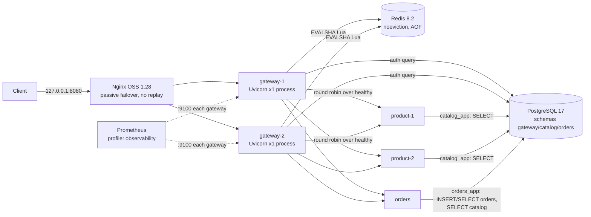

# Architecture

## Topology (normal Compose deployment)



Only Nginx publishes a port, and only on `127.0.0.1`. Every other service (gateways, backends,
PostgreSQL, Redis) is reachable only on the private Compose network. `compose.test.yaml` is the
explicit, opt-in override that publishes internal ports on `127.0.0.1` for tests and benchmarks.
It must be used with its own project name (`apigw-test`), so it has its own volumes.

Each application container runs exactly one Uvicorn process. All Python services share one image
(`Dockerfile`) and differ only in their command.

## Repository layout

| Path | Purpose |
|---|---|
| `gateway/app/` | Gateway: `main.py` (lifecycle), `service.py` (request pipeline), `auth.py`, `ratelimit/` (Lua + wrapper), `admission.py`, `backends.py` (health, DNS, round robin), `proxy.py` (headers, bounded I/O), `routing.py`, `metrics.py`, `errors.py`, `config.py`, `keys.py` |
| `gateway/admin.py` | Administrative CLI (clients, keys, policies) |
| `services/products/`, `services/orders/` | Backend services |
| `shared/` | Env parsing, JSON logging, bounded DB pool, dev fault controls, service plumbing |
| `database/` | `manage.py` (setup command), `migrations/*.sql`, `seeds/*.sql` |
| `config/` | Nginx, Redis, Prometheus configuration |
| `tests/unit`, `tests/integration` | Unit tests (no containers) / tests against the isolated stack |
| `load_tests/` | Locust workloads, raw results |
| `scripts/` | Test stack and benchmark helpers (PowerShell), result summarizer |

## Request lifecycle (gateway)

```mermaid
sequenceDiagram
    participant N as Nginx
    participant G as Gateway
    participant PG as PostgreSQL
    participant R as Redis
    participant B as Backend
    N->>G: request (+X-Request-ID)
    G->>G: route match (segment boundary) → 404
    G->>G: path safety / declared Content-Length → 400 / 413
    G->>G: global admission (nowait) → 503
    G->>PG: auth lookup by key_id (bounded acquire + statement timeout)
    PG-->>G: key, client, policy → 401 / 403 / 503
    G->>R: EVALSHA token_bucket|sliding_window (Redis TIME inside)
    R-->>G: allowed?, remaining, retry_after → 429 / 503
    Note over G: allowance is now consumed
    G->>G: read body chunk-wise ≤ 64 KiB, ≤ 5 s → 413 / 408
    G->>G: per-service admission (nowait) → 503
    G->>G: pick healthy instance (round robin) → 503
    G->>B: forward (one total 5 s deadline; GET retried once on connect failure)
    B-->>G: status/headers/body ≤ 1 MiB → 502 / 504
    G-->>N: backend status preserved + X-Request-ID, X-RateLimit-*
```

Details per step:

1. **Request id.** Nginx forwards the client's `X-Request-ID` or generates one. The gateway accepts
   exactly one value matching `^[A-Za-z0-9._-]{1,64}$` and otherwise generates a UUID.
2. **Routing.** Routes are fixed in code: `/products` maps to the products pool and `/orders` to the
   orders pool. Backend destinations come from configuration (`PRODUCTS_UPSTREAMS`,
   `ORDERS_UPSTREAMS`). A prefix matches only on a segment boundary, so `/products-other` returns 404.
   Raw paths containing dot segments, encoded `/`, `\` or `.`, or NUL are rejected with 400. This stops
   routes like `/products/../_dev` from reaching non-public backend paths.
3. **Authentication.** One indexed PostgreSQL query by `key_id` returns the key digest, revocation,
   expiry (evaluated with the database clock), client status and the client's global policy. There is
   no cache.
4. **Quota.** One Lua script per decision (see [design decisions](design-decisions.md#rate-limiting)).
5. **Forwarding.** One long-lived HTTPX `AsyncClient` per service is used, with a pool size equal to
   the service admission limit, and redirects and retries disabled. Requests connect to the address
   resolved by the health monitor and send `Host: <configured-name>:<port>`. Hop-by-hop headers
   (including those named by `Connection`), credentials, identity headers and forwarding headers are
   removed. The gateway then adds `X-Client-Id` (the authenticated id) and `X-Request-ID`.
6. **Response.** The status is relayed unchanged. Raw (still encoded) bytes are relayed, so
   `Content-Encoding` stays valid, and `Content-Length` is recomputed. Gateway-owned headers coming
   from the backend are dropped.

## Health and balancing

- **Gateway → products.** Each gateway independently round-robins over instances in state `healthy`.
  - **Startup.** An instance starts as `unknown`, which is not routable. The gateway runs one probe
    round before serving, and the first successful probe makes the instance healthy.
  - **Probes.** `GET /health/ready` every 2 s (0.5 s in the test stack) with a 0.5 s timeout. After 2
    consecutive failures an instance becomes unhealthy, and it needs 2 consecutive probe successes to
    recover.
  - **Request-time failures.** Connect and protocol errors on real requests count as failures too.
    GET/HEAD/OPTIONS requests that fail to *connect* are retried once on another healthy instance;
    nothing is retried after bytes were sent.
  - **DNS.** Names are resolved by the health monitor with at most one lookup in flight per instance,
    and requests never block on DNS. A lookup for a stopped container takes about 4 s inside Docker,
    and before this design such lookups starved the resolver thread pool (bug 6 in PROJECT_STATUS).
- **Nginx → gateways.** Nginx Open Source has no active health checks. Its `max_fails=2
  fail_timeout=5s` skips a failing gateway for 5 s. `proxy_next_upstream off` means a request is never
  replayed on the other gateway, which could double-consume quota or duplicate an order. The cost is
  that requests already routed to a dead gateway fail (502) until `max_fails` trips. `server ...
  resolve` with `resolver valid=5s` picks up recreated containers. Compose health status does not
  affect Nginx routing.
- **Liveness and readiness.**
  - Backends: liveness means the process responds. Readiness means the database answers `SELECT 1`
    within 0.5 s and no injected readiness fault is active.
  - Gateway: liveness means the process responds. Readiness means PostgreSQL and Redis both answer
    within 0.5 s.
  - Compose healthchecks use liveness, so a database outage does not cause restart storms.

## Data ownership and coupling

| Schema | Owner service | Access |
|---|---|---|
| `gateway` | gateway | `gateway_app`: SELECT only; the admin CLI uses the owner role |
| `catalog` | products | `catalog_app`: SELECT; `orders_app`: SELECT (documented read-only lookup for prices) |
| `orders` | orders | `orders_app`: SELECT, INSERT |

`orders.orders.product_id` has a foreign key to `catalog.products`, so orders depend on the catalog
schema. A single PostgreSQL instance hosts all three schemas, and a single Redis instance holds all
quota state. Both are local-development simplifications and single points of failure. See
[failure policy](failure-policy.md).
